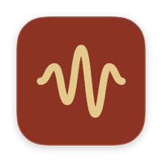

  <a href="https://apps.amansinghphotos.com">
    <picture>
      <source media="(prefers-color-scheme: dark)" srcset="Banner%20Dark.png">
      
    </picture>
  </a>

<b><a href="https://apps.amansinghphotos.com">apps.amansinghphotos.com</a></b>

## The Cast

| | | | |
|:-:|---|---|:-:|
|  | **Bolo** <i>speak</i> | **Takes down what you say.** Hold Right Option, talk, and let go; the words appear where you were typing. | [Download](https://apps.amansinghphotos.com/bolo/download/) |
|  | **Chanan** <i>light</i> | **Brings up the lights.** The full brightness of a MacBook Pro’s display, in every app. | [Download](https://apps.amansinghphotos.com/chanan/download/) |
|  | **Chete** <i>remembering</i> | **Remembers what you copied.** Everything you have copied, in one list, kept on your Mac. | [Download](https://apps.amansinghphotos.com/chete/download/) |
|  | **Pehra** <i>keeping watch</i> | **Keeps watch.** What your Mac is doing, at a glance from the menu bar. | [Download](https://apps.amansinghphotos.com/pehra/download/) |
|  | **Vela** <i>time</i> | **Keeps the time.** All your calendars in one, by day, week or month, and a line to add to them. | [Download](https://apps.amansinghphotos.com/vela/download/) |
| | **The Whole Company** | All five in one download. | [Download All Five](https://apps.amansinghphotos.com/all/download/) |

To install, open the download and drag the app to Applications. After that, the apps keep themselves up to date. They need an Apple silicon Mac with macOS 27. A Claude key of your own lets Bolo tidy what it hears.

<i>Made by Aman Singh.</i>

